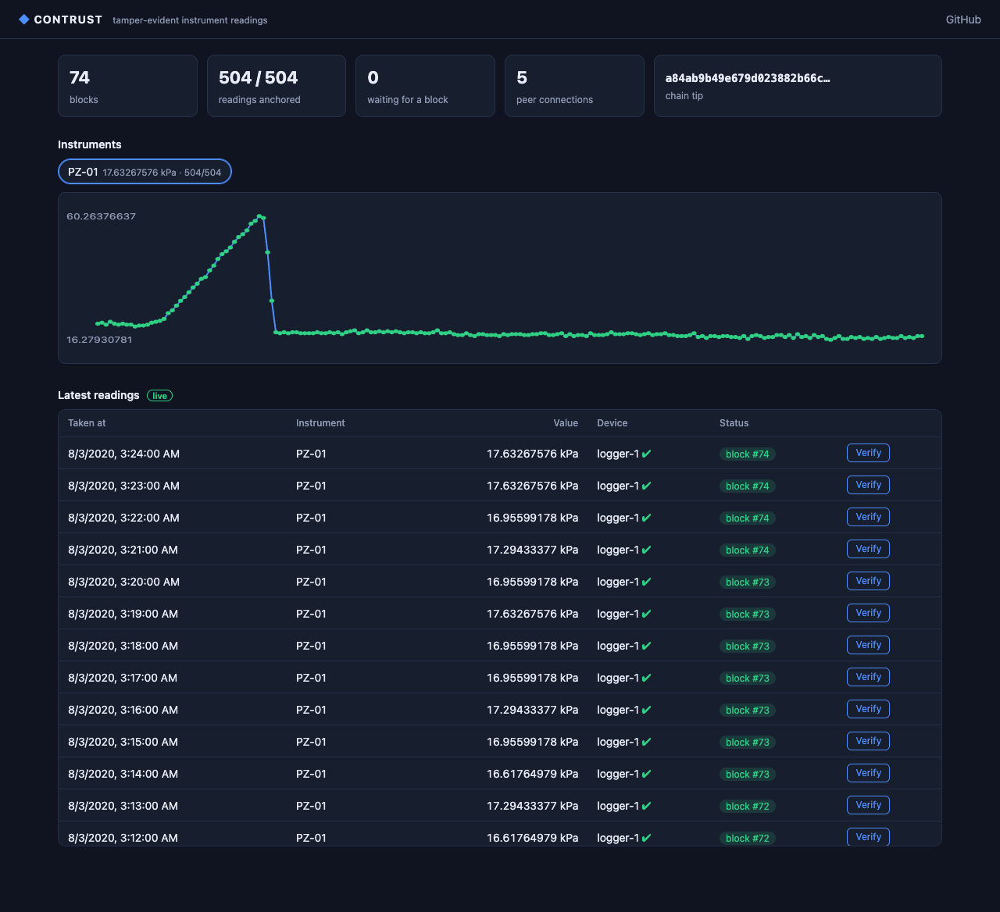
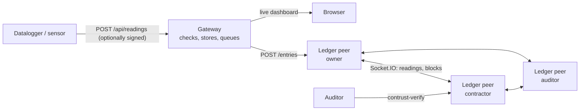

# CONTRUST

**Tamper-evident instrument readings for construction and infrastructure.**


Construction sites and infrastructure assets such as dams, embankments, tunnels and slopes are monitored by instruments: piezometers, inclinometers, settlement plates, strain gauges. Their readings decide whether work goes on, whether a contractor gets paid, and whether an alarm is raised. When a reading is questioned months later, in a claim, an audit or an accident report, everyone needs to know that it was not edited after the fact.

Contrust gives each reading that guarantee. Devices send readings to a **gateway**. The gateway checks them and hands them to a small network of **ledger peers**, one per party of the contract (owner, contractor, independent auditor). Every few seconds one of those parties seals the waiting readings into a block. The block records the hash of the previous block and the Merkle root of its readings, and the party signs it with its own key. Afterwards, changing any reading, removing one or reordering blocks breaks a hash or a signature, and anyone can check that with the included verifier, without trusting the server that answers.



## Quick start

Requires Node.js 18.17 or newer.

```bash
git clone https://github.com/Caumaker/Contrust.git
cd Contrust
npm install
npm run demo
```

`npm run demo` starts three ledger peers (ports 5101 to 5103), the gateway with the dashboard (http://localhost:6001) and a simulated datalogger. The datalogger replays a real piezometer series, signing each reading with its own key. Watch the readings arrive and get anchored, then press **Verify** on any of them.

In another terminal, check everything without trusting the peers:

```bash
npm run verify -- --peer http://localhost:5102          # the whole chain
npm run verify -- --peer http://localhost:5103 --reading <hash from the dashboard>
```

With Docker: `docker compose up`, then open http://localhost:6001.

Keys, tokens and data of the demo live in `./data/demo`. Delete that folder to start over.

## How it works



### A reading

```json
{ "instrumentId": "PZ-01", "takenAt": "2020-08-02T22:00:00.000Z", "value": 43.948, "unit": "kPa", "deviceId": "logger-1" }
```

`instrumentId`, `takenAt` (ISO 8601) and `value` (a number; field files with a decimal comma such as `"43,948"` are accepted) are required. `unit`, `raw` (the original line), `deviceId` and `meta` (any small object, up to 4 KB) are optional. The reading is normalized, then identified everywhere by its **hash**: SHA-256 of its canonical JSON, with keys sorted, so the same reading always gets the same hash on any machine.

A device can also **sign** each reading with an Ed25519 key, over the reading hash. If the device is registered in the gateway (`DEVICES_FILE`), unsigned or badly signed readings from it are refused. With `REQUIRE_SIGNATURES=true`, only signed readings from registered devices are accepted. The signature is stored in the ledger next to the reading, so the origin can be checked later too.

### A block

```json
{
  "header": {
    "version": 2, "chainId": "contrust-demo", "index": 18,
    "timestamp": "2026-11-23T03:40:11.512Z",
    "previousHash": "7aea533f...", "merkleRoot": "c0b9...", "count": 7,
    "sealer": "JSOULcnxpbo3DtRrO5yAMXx6jF7FPqxpUfnDWIxHJco="
  },
  "hash": "d691255b...",
  "signature": "base64 Ed25519 signature of hash by the sealer",
  "entries": [ { "hash": "e46e415e...", "reading": { }, "deviceSignature": "..." } ]
}
```

- `hash` is the SHA-256 of the canonical header. Since the header holds `previousHash`, every block commits to the whole history before it.
- `merkleRoot` commits to every reading of the block. A single reading can be proven with a short **Merkle path** (about log2 of the block size in hashes) instead of the whole block.
- `sealer` is the public key of the authority that sealed the block, and `signature` is its signature of `hash`.
- The genesis block is fixed by `chainId`: every peer of a network starts from the same block, and blocks from another network are refused.

### Who seals: proof of authority

There is no mining. The parties of the contract are the **authorities**, each with an Ed25519 key, and only they can seal blocks. They take turns: the authority expected for block `n` is `authorities[n mod count]`, with the list sorted. If no block has arrived for 9 seconds while readings are waiting, any authority seals, so a peer that is offline does not stop the network. A block holds up to 1000 readings, sorted by time.

When two peers disagree (a network split, two blocks at once), every peer keeps the **longer valid chain**, and on a tie the one whose last block has the lower hash. Every peer reaches the same answer. Readings from a discarded fork go back to the waiting pool, so none is lost.

### What every peer checks

A block is accepted only if all of this holds, and the same checks run on the whole file when a peer starts. A peer whose file was edited refuses to start.

- the index follows the previous block and `previousHash` is the previous block's hash
- `hash` matches the header, the timestamp does not go back and is not more than 2 minutes in the future
- the sealer is one of the authorities and the signature is valid
- every reading is valid, hashes to its declared hash and appears only once in the whole chain
- the Merkle root matches the readings

### What it guarantees, and what it does not

- **Guaranteed:** after a reading is anchored, any change to it, any removal or any reordering is detected by every peer and by the verifier. A signed reading also proves which device produced it.
- **Not guaranteed by itself:** a device that is wrong or compromised can still send false values. Signatures tell you which device to blame, not that the value is right. If all authorities collude, they can rewrite the history together. The usual protection is to give each party its own peer and to publish the chain tip periodically somewhere public: a public blockchain, a newspaper, an email to the regulator. That is on the roadmap.

## Running a real network

1. Each party creates its key on its own server and shares only the public key:
   ```bash
   node tools/keygen.js data/owner/peer.key
   ```
2. Agree on a `CHAIN_ID` and the list of public keys (`AUTHORITIES`). Write them in the contract or in a document all parties sign: it is what the verifier trusts.
3. Start each peer:
   ```bash
   PORT=5101 PEER_NAME=owner CHAIN_ID=dam-x-2026 DATA_DIR=data/owner \
   AUTHORITIES=<key1>,<key2>,<key3> PEERS=https://contractor.example:5101,https://auditor.example:5101 \
   GATEWAY_TOKEN=<secret> NETWORK_TOKEN=<secret> npm run ledger
   ```
4. Start the gateway near the instruments, pointing at one or more peers:
   ```bash
   PORT=6001 LEDGER_URLS=https://owner.example:5101 GATEWAY_TOKEN=<secret> NETWORK_TOKEN=<secret> \
   DEVICES_FILE=devices.json REQUIRE_SIGNATURES=true npm run gateway
   ```
   `devices.json` maps device ids to their public keys: `{ "logger-1": "base64 key" }`.

Put peers and gateway behind HTTPS (a reverse proxy such as Caddy or nginx). Tokens are compared in constant time, but they travel in headers and must not go over plain HTTP outside a private network.

### Configuration

| Variable | Used by | Default | Meaning |
|---|---|---|---|
| `PORT` | peer, gateway | 5101 / 6001 | HTTP port |
| `DATA_DIR` | peer, gateway | `./data/<name>` | where the chain, the key and the received readings are stored |
| `CHAIN_ID` | peer | `contrust-demo` | network name, part of every block |
| `PEER_NAME` | peer | `peer-<port>` | name in logs and in `/status` |
| `AUTHORITIES` | peer | this peer's key only | comma separated public keys allowed to seal |
| `PEERS` | peer | none | comma separated URLs of the other peers |
| `SEAL_INTERVAL_MS` | peer | 3000 | how often a peer checks whether it should seal |
| `GATEWAY_TOKEN` | peer, gateway | none | required on `POST /entries` when set |
| `NETWORK_TOKEN` | peer, gateway | none | required to open a Socket.IO connection to a peer when set |
| `LEDGER_URLS` | gateway | `http://localhost:5101` | peers to send readings to, tried in order |
| `DEVICE_TOKEN` | gateway | none | required on `POST /api/readings` (header `x-contrust-device-token`) when set |
| `DEVICES_FILE` | gateway | none | JSON file `{ deviceId: publicKey }` |
| `REQUIRE_SIGNATURES` | gateway | `false` | accept only signed readings from registered devices |

## API

### Gateway

| Method and path | What it does |
|---|---|
| `POST /api/readings` | Body: a reading, or `{ "reading": {...}, "signature": "..." }`. Answers `202` with `{ hash, state }`, where `state` is `pending` (with the ledger) or `queued` (ledger unreachable: it is retried every 5 s and survives restarts). A reading sent twice is answered with `duplicate: true`. |
| `GET /api/readings?instrument=&limit=` | Latest readings (up to 1000) with `state` and, when anchored, `block` and `blockHash`. |
| `GET /api/instruments` | One line per instrument: count, anchored, last value. |
| `GET /api/readings/:hash/proof` | The Merkle proof from the ledger plus the gateway's verification of it. |
| `GET /api/status` | Ledger status and reading counters. |

### Ledger peer

| Method and path | What it does |
|---|---|
| `GET /status` | Name, chain id, public key, authorities, height, tip, waiting readings, connections. |
| `POST /entries` | Used by the gateway (header `x-contrust-token`). Body `{ reading, deviceSignature? }`. |
| `GET /entries/:hash` | `anchored` (with block and confirmations), `pending` or `unknown`. |
| `GET /chain?from=` | Up to 500 blocks from that index, with the current height. |
| `GET /blocks/:index` | One block. |
| `GET /proof/:hash` | Everything needed to check one reading: the entry, its Merkle path, the block header, hash and signature, and the confirmations. |

Example from a device:

```bash
curl -X POST http://localhost:6001/api/readings -H 'content-type: application/json' \
  -d '{"instrumentId":"PZ-02","takenAt":"2026-11-22T10:00:00-03:00","value":12.7,"unit":"kPa"}'
```

## Verifying

`tools/verify.js` (also `npm run verify` and the `contrust-verify` binary) needs nothing but Node:

```bash
contrust-verify --peer https://owner.example:5101 --authorities <key1>,<key2>,<key3>
contrust-verify --peer https://owner.example:5101 --reading <hash> --authorities <keys>
contrust-verify --file data/owner/chain.jsonl --chain dam-x-2026 --authorities <keys>
```

It prints `VALID` or `INVALID` with the reason, and exits with status 0 or 2. Always pass `--authorities` from a source you trust, such as the contract. Without it, the verifier takes the list the peer reports, which only proves that the peer is consistent with itself.

The dashboard's **Verify** button repeats the hash, Merkle and block hash checks inside your browser from the raw proof, and shows the signature check done by the gateway.

## Devices

`devices/simulator.js` replays a datalogger export into the gateway, the way a field device would:

```bash
npm run simulate -- --instrument PZ-01 --unit kPa --interval 2000
npm run simulate -- --device logger-1 --key data/devices/logger-1.key   # signs, prints the public key to register
```

The file format is one reading per line, `D/M/YY H:MM<tab>value`, with day first and decimal comma, as many loggers export it. `--utc -03:00` sets the time zone of the file. The sample in `devices/data/sample-readings.txt` is a real piezometer series.

## Development

```bash
npm test
```

The tests cover canonical hashing, Merkle proofs of every size, reading validation, device signatures, chain validation against eight kinds of tampering, proof verification, fork choice, the file store, and two network runs: three peers plus a gateway with signed devices, and a gateway that keeps readings queued while the ledger is down and delivers them after a restart.

```
ledger/     peer: crypto.js, reading.js, chain.js, store.js, peer.js (HTTP + Socket.IO + sealing)
gateway/    gateway API and the dashboard (public/, no build step)
devices/    datalogger simulator and a real sample series
tools/      verify.js (independent verifier), keygen.js
scripts/    demo.js (whole network on one machine)
test/       node:test suites
```

## What changed from the 2021 version

The first version (`docs/img/architecture-2021.png`) proved the idea in a hackathon. Version 2 keeps the idea and rewrites the core so the guarantee actually holds:

- The block hash did not include the previous block's hash, so blocks could be reordered unnoticed. It does now.
- Proof of work was random guessing that did not depend on the block's content, and a global variable stopped mining. It is replaced by signatures of the contract's parties (proof of authority).
- Readings that arrived while a block was being mined could be lost. Waiting readings now stay in a pool until they are in the chain, including after a fork.
- Everything lived in memory. Chain and readings are stored on disk and validated on start.
- Any caller could make a peer connect to any address (`POST /nodes`). Peers now come from configuration, with tokens.
- Readings were squeezed into `sender`, `receiver` and `amount`. They now have their own model, optional device signatures and Merkle proofs.
- Dependencies from 2018 with known vulnerabilities, PM2 required and a Nuxt 2 sample app: now three dependencies (Express, Socket.IO and its client), a one-command demo, a dashboard without a build step, tests and CI.

## Roadmap

- Publish the chain tip periodically to a public blockchain or a timestamping service (external anchoring).
- Import AGS4 and common datalogger formats, and ingest from MQTT.
- Alarm thresholds per instrument, signed by the party that set them.

## Authors

Created by **Cauê Somensi** (original 2021 prototype by the Somenzi brothers). Version 2 was designed and written by Cauê Somensi with **Claude** (Anthropic).

## License

MIT. See [LICENSE](LICENSE).
