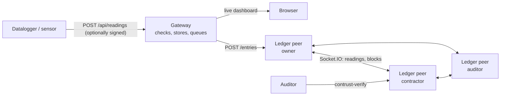

# CONTRUST

**Tamper-evident instrument readings for construction and infrastructure.**


Construction sites and infrastructure assets such as dams, embankments, tunnels and slopes are monitored by instruments: piezometers, inclinometers, settlement plates, strain gauges. Their readings decide whether work goes on, whether a contractor gets paid, and whether an alarm is raised. When a reading is questioned months later, in a claim, an audit or an accident report, everyone needs to know that it was not edited after the fact.

Contrust gives each reading that guarantee. Devices send readings to a **gateway**. The gateway checks them and hands them to a small network of **ledger peers**, one per party of the contract (owner, contractor, independent auditor). Every few seconds one party proposes a block with the waiting readings, and the block only counts once a **majority of the parties has signed it**. The block records the hash of the previous block and the Merkle root of its readings. Afterwards, changing any reading, removing one or reordering blocks breaks a hash or the signatures, no single party can rewrite the history alone, and anyone can check all of this with the included verifier, without trusting the server that answers.


## Quick start

Requires Node.js 18.17 or newer.

```bash
git clone https://github.com/Caumaker/Contrust.git
cd Contrust
npm install
npm run demo
```

`npm run demo` starts three ledger peers (ports 5101 to 5103), the gateway with the dashboard (http://localhost:6001) and a simulated datalogger. The datalogger replays a real piezometer series, signing each reading with its own key. Watch the readings arrive and get anchored, then press **Verify** on any of them.

In another terminal, check everything without trusting the peers:

```bash
npm run verify -- --peer http://localhost:5102          # the whole chain
npm run verify -- --peer http://localhost:5103 --reading <hash from the dashboard>
```

With Docker: `docker compose up`, then open http://localhost:6001.

Keys, tokens and data of the demo live in `./data/demo`. Delete that folder to start over.

## How it works



### A reading

```json
{ "instrumentId": "PZ-01", "takenAt": "2020-08-02T22:00:00.000Z", "value": 43.948, "unit": "kPa", "deviceId": "logger-1" }
```

`instrumentId`, `takenAt` (ISO 8601 with its time zone, `Z` or `-03:00`: a bare local time would depend on the clock settings of whoever reads it) and `value` (a number; decimal strings such as `"43,948"` from field files are accepted, nothing else) are required. `unit`, `raw` (the original line), `deviceId` and `meta` (any small object, up to 4 KB) are optional. The reading is normalized, then identified everywhere by its **hash**: SHA-256 of its canonical JSON, with keys sorted, so the same reading always gets the same hash on any machine.

A device can also **sign** each reading with an Ed25519 key, over the reading hash. If the device is registered in the gateway (`DEVICES_FILE`), unsigned or badly signed readings from it are refused. With `REQUIRE_SIGNATURES=true`, only signed readings from registered devices are accepted. The signature is stored in the ledger next to the reading and is covered by the block's Merkle root, so the origin can be checked later too.

### A block

```json
{
  "header": {
    "version": 3, "chainId": "contrust-demo", "index": 18,
    "timestamp": "2026-11-23T03:40:11.512Z",
    "previousHash": "7aea533f...", "merkleRoot": "c0b9...", "count": 7,
    "sealer": "JSOULcnxpbo3DtRrO5yAMXx6jF7FPqxpUfnDWIxHJco="
  },
  "hash": "d691255b...",
  "signatures": [ { "signer": "JSOUL...", "signature": "base64 Ed25519" }, { "signer": "l6iWg...", "signature": "..." } ],
  "entries": [ { "hash": "e46e415e...", "reading": { }, "deviceSignature": "..." } ]
}
```

- `hash` is the SHA-256 of the canonical header. Since the header holds `previousHash`, every block commits to the whole history before it.
- `merkleRoot` commits to every reading of the block, together with its device signature. A single reading can be proven with a short **Merkle path** (about log2 of the block size in hashes) instead of the whole block.
- `sealer` is the authority that proposed the block. `signatures` are the authorities' Ed25519 signatures of `hash`: a block needs more than half of the authorities.
- The genesis block is fixed by `chainId`: every peer of a network starts from the same block, and blocks from another network are refused.

### Who seals: a majority of the parties

There is no mining. The parties of the contract are the **authorities**, each with an Ed25519 key.

1. The authority whose turn it is (`authorities[n mod count]`, list sorted) proposes block `n` with the waiting readings (up to 1000, sorted by time) and signs it.
2. Every other authority checks the proposal: the link to the previous block, each reading and the Merkle root. If it has not signed another block at that height, it signs this one and sends its signature to the others. That promise is written to disk before the signature leaves, so it survives restarts.
3. As soon as a peer holds signatures from more than half of the authorities (2 of 3, 3 of 5), the block is **certified**. Every peer appends it, and it is final: there are no forks to choose between and no rollbacks.

If the authority whose turn it is stays silent for 9 seconds while readings are waiting, any authority may propose. Readings that were in a proposal that never got certified go back to the waiting pool.

Since an honest authority never signs two blocks at the same height, two certified blocks at the same height would need a majority to cheat. One party alone, or a minority, cannot seal anything, and cannot build an alternative history, whatever its length. The price is the usual one for this kind of agreement: without a majority online nothing is certified (readings wait, nothing is lost), and in a rare split during a proposal the network can wait for the missing authority to come back.

### What every peer checks

A block is accepted only if all of this holds, and the same checks run on the whole file when a peer starts. A peer whose file was edited refuses to start. A last line cut by a power loss is dropped (it was never confirmed), and blocks are written to disk before they enter memory.

- every field has the expected type and format (anything else in a block received from the network is dropped)
- the index follows the previous block and `previousHash` is the previous block's hash
- `hash` matches the header; the timestamp does not go back and, for new blocks, is not more than 2 minutes in the future
- the proposer is an authority, and more than half of the authorities signed `hash`
- every reading is valid, hashes to its declared hash and appears only once in the whole chain
- the Merkle root matches the readings and their device signatures

### What it guarantees, and what it does not

- **Guaranteed:** after a reading is anchored, any change to it or to its device signature, any removal inside the chain or any reordering is detected by every peer and by the verifier. No single party, nor any minority, can certify a block or rewrite the history. A signed reading also proves which device produced it.
- **Not guaranteed by itself:** a device that is wrong or compromised can still send false values. Signatures tell you which device to blame, not that the value is right. A majority of the authorities acting together can certify what it wants. A server can also hide the newest blocks (serve a shorter chain): to rule that out, the parties publish the tip hash now and then (an email to the regulator, a public blockchain) and auditors pass it to the verifier with `--tip`. Automatic publication is on the roadmap.

## Running a real network

1. Each party creates its key on its own server and shares only the public key:
   ```bash
   node tools/keygen.js data/owner/peer.key
   ```
2. Agree on a `CHAIN_ID` and the list of public keys (`AUTHORITIES`). Write them in the contract or in a document all parties sign: it is what the verifier trusts.
3. Start each peer:
   ```bash
   PORT=5101 PEER_NAME=owner CHAIN_ID=dam-x-2026 DATA_DIR=data/owner \
   AUTHORITIES=<key1>,<key2>,<key3> PEERS=https://contractor.example:5101,https://auditor.example:5101 \
   GATEWAY_TOKEN=<secret> NETWORK_TOKEN=<secret> npm run ledger
   ```
4. Start the gateway near the instruments, pointing at one or more peers:
   ```bash
   PORT=6001 LEDGER_URLS=https://owner.example:5101,https://auditor.example:5101 CHAIN_ID=dam-x-2026 AUTHORITIES=<key1>,<key2>,<key3> \
   GATEWAY_TOKEN=<secret> NETWORK_TOKEN=<secret> DEVICES_FILE=devices.json REQUIRE_SIGNATURES=true npm run gateway
   ```
   `devices.json` maps device ids to their public keys: `{ "logger-1": "base64 key" }`. The gateway checks every block against its own `AUTHORITIES`, not against the list a peer reports, before it marks a reading as anchored. Both tokens are required on peers (`INSECURE=true` allows running without them, for local experiments only).

Put peers and gateway behind HTTPS (a reverse proxy such as Caddy or nginx). Tokens are compared in constant time, but they travel in headers and must not go over plain HTTP outside a private network.

### Configuration

| Variable | Used by | Default | Meaning |
|---|---|---|---|
| `PORT` | peer, gateway | 5101 / 6001 | HTTP port |
| `DATA_DIR` | peer, gateway | `./data/<name>` | where the chain, the key and the received readings are stored |
| `CHAIN_ID` | peer, gateway | `contrust-demo` / taken from the peer | network name, part of every block |
| `PEER_NAME` | peer | `peer-<port>` | name in logs and in `/status` |
| `AUTHORITIES` | peer, gateway | this peer's key only / taken from the peer | comma separated public keys of the parties; a block needs more than half of them. Set it on the gateway: without it the gateway trusts the list the peer reports |
| `PEERS` | peer | none | comma separated URLs of the other peers |
| `SEAL_INTERVAL_MS` | peer | 3000 | how often a peer checks whether it should seal |
| `GATEWAY_TOKEN` | peer, gateway | required | header `x-contrust-token` on `POST /entries` |
| `NETWORK_TOKEN` | peer, gateway | required | needed to open a Socket.IO connection to a peer (proposals, signatures, blocks, readings) |
| `INSECURE` | peer | `false` | `true` runs a peer without tokens, for local experiments only |
| `LEDGER_URLS` | gateway | `http://localhost:5101` | peers to send readings to, tried in order |
| `DEVICE_TOKEN` | gateway | none | required on `POST /api/readings` (header `x-contrust-device-token`) when set |
| `DEVICES_FILE` | gateway | none | JSON file `{ deviceId: publicKey }` |
| `REQUIRE_SIGNATURES` | gateway | `false` | accept only signed readings from registered devices |

## API

### Gateway

| Method and path | What it does |
|---|---|
| `POST /api/readings` | Body: a reading, or `{ "reading": {...}, "signature": "..." }`. Answers `202` with `{ hash, state }`, where `state` is `pending` (with the ledger) or `queued` (ledger unreachable). Until a reading is anchored the gateway keeps it: queued ones are retried every 5 s, and pending ones are sent again every 30 s in case a peer lost them in a restart. A reading sent twice is answered with `duplicate: true`. |
| `GET /api/readings?instrument=&limit=` | Latest readings (up to 1000) with `state` and, when anchored, `block` and `blockHash`. |
| `GET /api/instruments` | One line per instrument: count, anchored, last value. |
| `GET /api/readings/:hash/proof` | The Merkle proof from the ledger plus the gateway's verification of it against its own `AUTHORITIES` and `CHAIN_ID`. |
| `GET /api/status` | Ledger status and reading counters. |

### Ledger peer

| Method and path | What it does |
|---|---|
| `GET /status` | Name, chain id, public key, authorities, height, tip, waiting readings, connections. |
| `POST /entries` | Used by the gateway (header `x-contrust-token`). Body `{ reading, deviceSignature? }`. |
| `GET /entries/:hash` | `anchored` (with block and confirmations), `pending` or `unknown`. |
| `GET /chain?from=` | Up to 100 blocks from that index, with the current height. |
| `GET /blocks/:index` | One block. |
| `GET /proof/:hash` | Everything needed to check one reading: the entry, its Merkle path, the block header, hash and signatures, and the confirmations. `reportedAuthorities` is what this peer says; auditors check against their own list. |

Example from a device:

```bash
curl -X POST http://localhost:6001/api/readings -H 'content-type: application/json' \
  -d '{"instrumentId":"PZ-02","takenAt":"2026-11-22T10:00:00-03:00","value":12.7,"unit":"kPa"}'
```

## Verifying

`tools/verify.js` (also `npm run verify` and the `contrust-verify` binary) needs nothing but Node:

```bash
contrust-verify --peer https://owner.example:5101 --chain dam-x-2026 --authorities <key1>,<key2>,<key3>
contrust-verify --peer https://owner.example:5101 --chain dam-x-2026 --reading <hash> --authorities <keys>
contrust-verify --file data/owner/chain.jsonl --chain dam-x-2026 --authorities <keys> --tip <published tip hash>
```

It prints `VALID` or `INVALID` with the reason, and exits with status 0 or 2. Always pass `--authorities` from a source you trust, such as the contract. Without it, the verifier takes the list the peer reports, which only proves that the peer is consistent with itself. For a reading it also checks that the proof is about the hash you asked for and, with `--chain`, about your network. `--tip` checks that a block hash the parties published is in the chain, which rules out a chain cut short.

The dashboard's **Verify** button repeats the hash, Merkle and block hash checks inside your browser from the raw proof, and shows the signature check done by the gateway.

## Devices

`devices/simulator.js` replays a datalogger export into the gateway, the way a field device would:

```bash
npm run simulate -- --instrument PZ-01 --unit kPa --interval 2000
npm run simulate -- --device logger-1 --key data/devices/logger-1.key   # signs, prints the public key to register
```

The file format is one reading per line, `D/M/YY H:MM<tab>value`, with day first and decimal comma, as many loggers export it. `--utc -03:00` sets the time zone of the file. The sample in `devices/data/sample-readings.txt` is a real piezometer series.

## Development

```bash
npm test
```

17 tests cover canonical hashing, Merkle proofs of every size, strict reading and block validation, device signatures, nine kinds of tampering, the rule that one authority alone certifies nothing (not even a longer history built offline), proofs about another reading or chain, a torn file, token handling that never throws, and network runs: three authorities with a gateway and signed devices, a network without a majority that resumes when one returns, unauthenticated clients, a reading lost in a peer restart and sent again, a peer catching up page by page, and a gateway ignoring blocks its authorities did not certify.

```
ledger/     peer: crypto.js, reading.js, chain.js, store.js, votes.js, peer.js (HTTP + Socket.IO + propose, sign, certify)
gateway/    gateway API and the dashboard (public/, no build step)
devices/    datalogger simulator and a real sample series
tools/      verify.js (independent verifier), keygen.js
scripts/    demo.js (whole network on one machine)
test/       node:test suites
```

## What changed from the 2021 version

The first version (`docs/img/architecture-2021.png`) proved the idea in a hackathon. Version 2 keeps the idea and rewrites the core so the guarantee actually holds:

- The block hash did not include the previous block's hash, so blocks could be reordered unnoticed. It does now.
- Proof of work was random guessing that did not depend on the block's content, and a global variable stopped mining. It is replaced by blocks certified by a majority of the contract's parties.
- Readings that arrived while a block was being mined could be lost. Waiting readings now stay in a pool until they are in the chain, including after a fork.
- Everything lived in memory. Chain and readings are stored on disk and validated on start.
- Any caller could make a peer connect to any address (`POST /nodes`). Peers now come from configuration, with tokens.
- Readings were squeezed into `sender`, `receiver` and `amount`. They now have their own model, optional device signatures and Merkle proofs.
- Dependencies from 2018 with known vulnerabilities, PM2 required and a Nuxt 2 sample app: now three dependencies (Express, Socket.IO and its client), a one-command demo, a dashboard without a build step, tests and CI.

## Roadmap

- Publish the chain tip periodically to a public blockchain or a timestamping service (external anchoring).
- Import AGS4 and common datalogger formats, and ingest from MQTT.
- Alarm thresholds per instrument, signed by the party that set them.

## Authors

Created by **Cauê Somensi** (original 2021 prototype by the Somenzi brothers). Version 2 was designed and written by Cauê Somensi with **Claude** (Anthropic), and hardened after an independent adversarial review.

## License

MIT. See [LICENSE](LICENSE).
